# AnyTime NTP Director

AnyTime gives a group of machines one shared NTP address. Clients point at that address, called a **gateway**, and every node answers it. The nodes agree among themselves, over a small multicast or unicast protocol, who owns which share of the traffic, so a node can fail or restart without clients noticing.

What you get:

- **One shared address, answered by every node.** Clients are spread across the nodes, and the address survives the loss of any of them.
- **An NTP relay on each node.** It forwards every client's NTP packet to the fastest healthy upstream server, spreads load across servers of similar speed, fails over when one goes down or turns out to be a falseticker, and never relays control packets.
- **Chrony for the node's own clock.** The installer sets chrony up as a prerequisite, serving only on the first Ethernet interface's own addresses, so it never collides with the relay on a gateway address.
- **Per-client rate limiting** and a list of the clients that may use the relay.
- **Anycast addresses over BGP.** Gateways can announce extra addresses to your routers through FRR, and withdraw them when no upstream server is healthy.
- **A web GUI and a command line** that manage the whole cluster. Draw gateways and NTP servers on a topology page, watch live statistics, and keep shared settings, config versions, certificates and software updates in step across all your nodes.

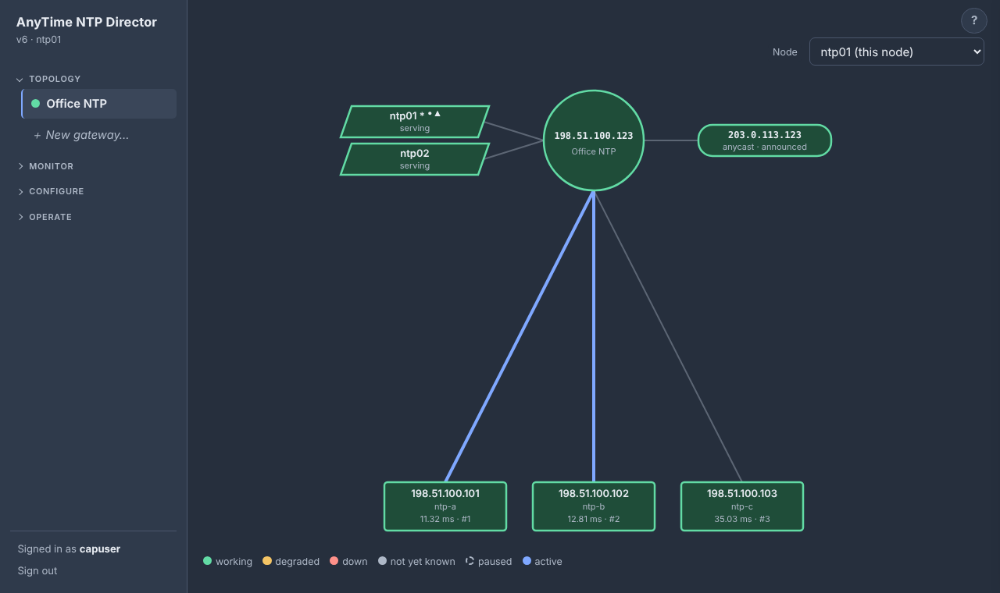

## Contents

- [How it works](#how-it-works)
- [Install, upgrade, uninstall](#install-upgrade-uninstall)
- [The NTP relay](#the-ntp-relay)
- [Topology](#topology)
- [Anycast addresses and BGP](#anycast-addresses-and-bgp)
- [Gateway roles, virtual MACs and real-MAC mode](#gateway-roles-virtual-macs-and-real-mac-mode)
- [The web GUI](#the-web-gui)
- [Users](#users)
- [Config history](#config-history)
- [The GUI certificate](#the-gui-certificate)
- [Clustering](#clustering)
- [Monitoring: statistics, host, capture and log](#monitoring)
- [Operating a node](#operating-a-node)
- [Upgrading a running cluster](#upgrading-a-running-cluster)
- [Build from source](#build-from-source)
- [License](#license)

## How it works

A **gateway** is one shared address, its **VIP** (IPv4, IPv6 or both), served by several nodes.

The nodes of a gateway find each other over multicast, or over a unicast list of every node's address where multicast is blocked, and elect one **controller (AGC)**. The others are **forwarders (AFN)**. The controller answers ARP (IPv4) and neighbour solicitations (IPv6) for the VIP with the MAC address of a node picked by the gateway's load-balancing method, so clients are spread over all the nodes.

That MAC is normally a virtual one per node, which another node takes over when the node stops or fails. With **real MAC addresses** switched on (the default for a gateway you create, see [Real-MAC mode](#real-mac-mode-no-virtual-macs)), it is the node's own MAC. Virtual MACs need Linux, macvlan support and root.

Every node answers NTP on the VIP through the same relay. It probes the upstream servers you give the gateway with real NTP requests and forwards each client packet to the fastest healthy one. Extra **anycast** addresses on a gateway can be announced to your routers over BGP.

Several nodes can be managed as one **cluster**. Shared settings, config history, certificates and software updates are kept in step from any node. The cluster is for management only and is independent of the gateway election.

## Install, upgrade, uninstall

New here? `QUICKSTART.md` at the top of the tarball walks through the install, the first gateway and the web GUI.

### From GitHub

To install the latest tagged release straight from GitHub (this also upgrades an existing install):

```
curl -fsSL https://raw.githubusercontent.com/micush/ntpdir/HEAD/get.sh | sudo bash
```

`get.sh` finds the newest GitHub release (or, if there is none, the highest `v<number>` tag), downloads that tag's source archive and runs its `install.sh`. Everything after `--` goes to `install.sh`, except `--version TAG`, which installs that tag instead. It needs `curl` or `wget`, and `tar`. To publish a version, push a tag named `v<VERSION>` (for example `v223`).

### From a tarball

```
tar xzf ntpdir_vN.tgz && cd ntpdir
sudo ./install.sh [--add-user NAME] [--no-start] [--no-keep-go] [--force] [-y] [--dry-run]
sudo ntpdir-uninstall [--purge] [--remove-group] [-y]
```

Supported systems are Ubuntu, Debian, Fedora, RHEL, Rocky, Alma, Arch and Manjaro, and derivatives that list one of them in `ID_LIKE`.

### What the installer does

The installer builds AnyTime from the source tree, installing only the prerequisites that are missing:

- **chrony** (enabled and started; see below), **gcc and the PAM headers**, **iproute2**, **FRR** (for the Anycast pages) **nmap**, **ping** and **mtr** (for Scan, Ping and Traceroute on the Statistics page).
- **A Go toolchain, version 1.24 or newer.** It is taken from the distribution's own package (`golang-1.2x-go`, `golang-go`, `golang` or `go`) when that is recent enough. Otherwise it is downloaded from go.dev with a checksum check. A downloaded toolchain is kept in `/usr/local/share/ntpdir/go`, because the daemon rebuilds itself with it when you apply an update; `--no-keep-go` removes it.
- FRR comes from the distribution's `frr` package (EPEL on the RHEL family). If that fails the installer only warns, and AnyTime leaves FRR untouched until a local AS is set on the Anycast page. A failed nmap, ping or mtr install is a warning too; only Scan, Ping and Traceroute need them.

**chrony.** It keeps the node's own clock right, and the installer adds a marked block to its configuration (`/etc/chrony/chrony.conf` on Debian and Ubuntu, `/etc/chrony.conf` elsewhere): `bindaddress` for the first IPv4 and the first IPv6 address of the first Ethernet interface (the lowest-named physical one) and `allow ::/0` and `allow 0.0.0.0/0`, so chrony serves NTP only on those addresses. The relay listens on the gateway addresses, so the two share UDP 123 without clashing. chrony is enabled and restarted when the block changes. The uninstaller removes the block and leaves chrony installed.

It then installs `/usr/local/sbin/ntpdir`, the state directory `/var/lib/ntpdir` (mode 0700), the `ntpdir` group, `/etc/pam.d/ntpdir`, a NetworkManager drop-in that leaves the `ntpdir*` macvlan interfaces alone, and the `ntpdir` systemd unit.

### Upgrading and uninstalling

If AnyTime is already installed, the script upgrades it. The config, certificate, group members and an existing PAM file are kept, and the old binary is saved as `/usr/local/share/ntpdir/ntpdir.prev`. If the new version does not start, the old one is restored. Installing the same version is a no-op, `--force` reinstalls, and a downgrade needs `--force`.

The user who ran the installer (the one behind `sudo`) is added to the `ntpdir` group so they can log in to the GUI; `--add-user NAME` adds others. Uninstalling keeps `/var/lib/ntpdir` (the config, the certificate, config history and the cluster identity) unless you give `--purge`.

### Where things live

Everything AnyTime keeps is in `/var/lib/ntpdir` (mode 0700): `ntpdir.conf`, the GUI certificate, `versions/`, the cluster identity and the update data. The control socket is `/run/ntpdir/ntpdir.sock`.

### Fresh start or cloned VM

If `ntpdir.conf` does not exist, the daemon creates it with the defaults and **no gateways**, then starts. You draw the gateways on the Topology page.

To reset a node, stop the service, run `rm -rf /var/lib/ntpdir/*` and start it again. The web certificate and the cluster identity are regenerated too, so give a cloned machine its own address first.

## The NTP relay

Every gateway serves NTP on its VIP; there is no switch for it. Give the gateway its upstream servers, either by drawing them on the Topology page or in Configure ▸ NTP relay ▸ Servers (the shared list every gateway without its own uses). A client sends an NTP packet to the VIP, the relay forwards it unchanged to the fastest healthy upstream server, and sends the server's answer back to the client. The server's answer is accepted only if it echoes the client's transmit timestamp, so a stray or forged packet is never passed on. Control and private-mode packets (modes 6 and 7) are never relayed.

The NTP page (Monitor ▸ NTP, or `ntpdir --show-ntp`) shows the ranking, health, round trip, offset, stratum and counters of every pool.

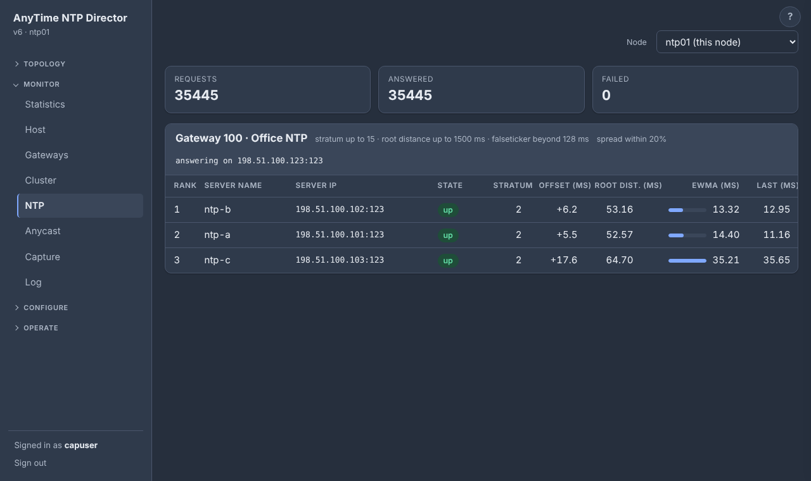

In the GUI, the settings are under Configure ▸ NTP relay, on four tabs: **Servers**, **Health & balancing**, **Listener** and **Clients**. In the file they are the top-level `ntp` block (shared by the cluster) and, per gateway, an optional `ntp` block inside the group.

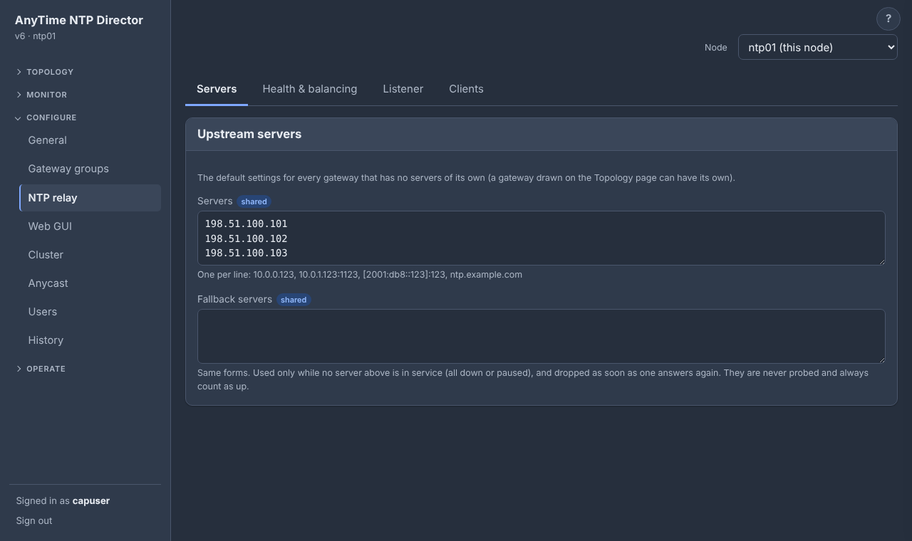

**Relay caveat.** The upstream servers see the relay's address for every client, so a server that rate-limits by source address limits all your clients together. Give the relay's address a generous limit on your own servers, or list several servers.

### Choosing an upstream server

- **Probing.** Every `probe_interval_ms` (default 16000) the relay sends each server a real NTP client request (timeout `probe_timeout_ms`, default 1000). The offset and delay come from the four timestamps (RFC 5905).
- **Eligibility.** A server is healthy when it answers, its stratum is at most `max_stratum` (default 15; 16 is an unsynchronised clock), its root distance is at most `max_root_distance_ms` (default 1500; 0 turns the check off) and it did not answer with a kiss-o'-death or the unsynchronised leap indicator. It is down after `fail_threshold` (default 2) failures in a row.
- **Falsetickers.** With three or more servers, one whose offset differs from the median of the servers' by more than `max_offset_ms` (default 128; 0 turns it off) is taken out of service until it agrees again.
- **Ranking.** Healthy servers are ranked by their smoothed round-trip time (an EWMA, `latency_alpha`, default 0.3).
- **Spread.** The healthy servers whose smoothed round trip is within `spread_band` percent of the fastest one's (default 20, range 1–1000) take turns, so the load is shared; `"spread": false` sends everything to the fastest. When the server whose turn it is does not answer within `query_timeout_ms` (default 800), the next is tried, up to `max_attempts` (default 2).

**Where the load-balancing settings live.** Spread, spread band, highest stratum, largest root distance, falseticker offset, failures before down, servers tried and round-trip smoothing are the Settings values, shared by the cluster. A gateway can have its own set (Topology ▸ right-click the gateway ▸ Edit ▸ Load balancing ▸ own values; CLI `--canvas-set gateway … --spread-band …`).

### Fallback servers

`fallback_servers` in the `ntp` block lists upstreams that are used **only while no normal server is in service**: every one down or paused, or none listed. They are **never probed** and always count as up. As soon as a normal server answers again, the fallbacks are dropped. The NTP page marks them and says when they are in use, and the canvas shows amber "answering from the fallback servers".

### Listener and clients

The relay answers on `listen_port` (default 123) on each gateway address. Server addresses are written `10.0.0.123`, `10.0.0.123:1123`, `[2001:db8::123]:123` or a host name. A relay never forwards a packet to the client that sent it or to this host's own addresses (a loop guard).

**Allowed clients.** `allowed_clients` lists the networks that may use the relay (`10.0.0.0/8`, `192.168.1.5`, `2001:db8::/32`); empty means everyone.

**Client rate limiting.** These settings are in the top-level `ntp` block (Configure ▸ NTP relay ▸ Clients ▸ Client Rate Limiting) and apply to every gateway.

- **`client_rate`** limits each client (one IPv4 address, or one IPv6 /64) to that many requests per second; 0 is no limit. **`client_burst`** is how many it may send at once (0 means twice the rate, at least 10).
- **`client_action`** is what a client over its rate, or outside `allowed_clients`, gets: `drop` (nothing is sent: the default and the safest, since a forged source address cannot be used to bounce answers at someone) or `kod` (a kiss-o'-death, RATE or RSTR, which a polite client reads as "slow down").
- **`client_exempt`** lists networks never limited. **`client_limits`** gives one client or network a rate of its own, one `"ADDRESS RATE"` entry each (`"192.168.1.5 50"`), even when `client_rate` is 0.

The node itself (loopback) is always allowed and never limited. The NTP page and `--show-ntp` show the limit and how many requests were turned away.

### Hot reload

The whole `ntp` block hot-reloads when you edit the file or use the GUI; a gateway's pool is only rebuilt when its servers or timing change.

## Topology

The first page of the GUI is a drawing of your configuration. Each **gateway is an item under Topology** in the sidebar (right-click it ▸ **Rename** or **Delete**), with *＋ New gateway…* at the end.

The drawing has two kinds of shape, plus the anycast pills:

- a **circle** for the gateway (its shared address, the VIP),
- a **square** under it for every NTP server it forwards to.

**The drawing is the gateway, not the selected node.** When the node picked in the Node menu does not serve the gateway (another subnet, removed from it, or paused there), it has no servers probed of its own. The circle, servers and anycast addresses are then those of a node that does serve it, asked over the cluster channel, and the circle's tooltip says which ("As NODE sees it"). The node shapes still say what each node, this one included, is doing. If no node serves the gateway, or the one asked does not answer within a few seconds, you see the selected node's own view. `ntpdir --canvas` is always the node's own view.

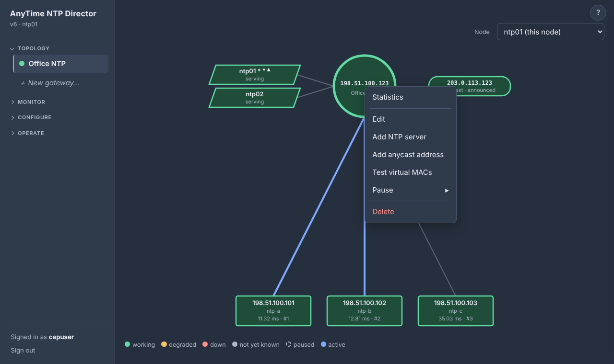

### What the colours mean

The colours come from the running daemon.

- **Green** is working.
- **Yellow** is degraded: the gateway runs but a server is down, or the gateway is answering from its fallback servers.
- **Red** is down: no healthy server.
- **Grey** is not known yet (not applied, or not probed yet).
- **Dashed grey** is paused.

A gateway's dot in the sidebar is the state of the gateway for the **cluster as a whole**, built from its nodes and the same whichever node the Node menu has selected. It is green while any node serves it, amber while it is only served degraded, dashed grey when every node has it paused, and red when no node serves it. A node on another subnet that does not run the gateway does not count against it.

The circle shows just the address (no prefix length) and sizes itself to fit even a full IPv6 address. A dual-stack gateway shows both, with a small green, yellow or red chip for each family, and the gateway's own colour is the worst of the two (an IPv6 engine that is not serving is yellow even if IPv4 is fine). Hover the circle to see which cluster nodes are serving the gateway right now: which is this node, which is the controller, and each node's slot.

A server is probed with real NTP requests (see [The NTP relay](#the-ntp-relay)); a server that is down, a falseticker, or above the stratum or root-distance limit is red.

Every tooltip ends with the item's **uptime**: how long the gateway, anycast address, server has been online since it last came back, or how long it has been down, and how many failures it has had ("Online for 1m 1s - 0 failures"). Green and yellow count as online; paused and grey items show nothing. A sampler in the daemon notes the changes every 2 seconds (no browser needed), in memory only, so the counting, failures included, restarts with ntpdir. `ntpdir --canvas` prints the same in brackets.

### The cluster nodes

Each node of the cluster (or just this node, when it is alone) is a **parallelogram** to the left of the circle, this node first and marked with a star. It is named by host name (by address when two nodes share a name), with how it stands for this gateway:

- green *serving*,
- amber *not serving* (up, but not serving the gateway yet),
- amber *degraded* (serving, but its own view of the gateway is degraded, for example because some of its NTP servers are down),
- dashed *paused* (the node is paused on the Operate page, or the gateway is paused or absent there), and
- red dashed *not answering*.

A node whose **CPU, memory or fullest disk is over 85%** is **solid yellow** (degraded), whatever else it is doing, even paused. It names what is over ("CPU 91% · disk 88%"; the tooltip names the mount) until every one is back at 85% or below. The figures are the Monitor ▸ Host numbers: the last 10-second CPU sample, memory in use, and the fullest of the tracked filesystems. The log records it too: a warning when a node goes over (naming CPU, memory and/or disk) and an info line when it is back at or under, for this node and every reachable member, checked each sync interval. A reading that only moves while still over is not logged again.

Hover a node for its address, role, last-seen time, version, whether it has caught up with the primary's settings, and any update under way. Right-click a reachable node for:

- *Pause node* or *Resume node* (another node is paused through the cluster, like the Node page does with the Node menu; its shape reads "pausing…" until it reports back),
- *Remove from this gateway* (see below),
- *Host statistics*, and, for another node, *Open this node* (the same as the Node menu, top right).

For an unreachable node the menu offers *Cluster page*. Nodes are read-only here; add or remove them on the Cluster page. `ntpdir --canvas` lists them as `/_/ cluster node` lines.

### Which nodes serve a gateway

Every node that is in the cluster serves every gateway unless it is removed from it. To change that, right-click a node ▸ *Remove*, or right-click the gateway ▸ *Add node* ▸ the node. On the command line, use `--canvas-del node --group N --node NODE` and `--canvas-add node --group N --node NODE`, where NODE is the node's address or host name.

The removal is **shared** (`excluded_nodes` in the gateway's block, a list of node IDs, absent while empty so older versions still read the file). Any node can change it, every node follows, and it survives restarts. A removed node behaves as if the gateway were paused on it: it resigns, gives up the address, and stops answering and probing for that gateway only. Its shape is no longer drawn on that gateway on any node (`ntpdir --canvas` still lists it, as *removed*), and the gateway's circle on that node says it was removed. *Add node* on the gateway lists the removed nodes by name.

A node that **joins** the cluster later is left out of every gateway when it joins (the primary adds it to each gateway's `excluded_nodes` before the joiner's first sync), so joining changes nothing about who answers. Put it where it should serve with right-click the gateway ▸ *Add node*. Gateways created afterwards are served by every node. The last node serving a gateway cannot be removed; pause the gateway on all nodes instead. This is not the same as *Pause ▸ This node*, which is kept on that node alone, for maintenance.

### Layout of the drawing

The anycast addresses (right of the circle) and the cluster nodes (left) stand four to a column, and the fifth starts a new column further out, and so on. When a four-row side would have a line to a server run through a box, both sides use three rows instead. Anycast addresses can be dragged to any slot, in any column. The drawing grows wider as columns are added (pan with the mouse).

**Zoom, pan and arrange.** Dragging the empty background moves around the drawing in any direction. The mouse wheel over the drawing zooms it (20% to 300%, around the pointer); the zoom is kept across refreshes and reset when you pick another gateway, and a double-click on the empty drawing fits it to the window again. **Drag** a server left or right, or an anycast address up or down to put it in another place. A dashed outline shows where it will land, letting go saves the new order, Escape puts it back, and a click without moving still just selects. The order is only how things are drawn and probed (servers are still chosen by speed). CLI: `ntpdir --canvas-move server|anycast … --to N`.

### Editing the drawing

**Right-click** anything. The circle offers *Statistics*, *Edit*, *Add NTP server*, *Add anycast address*, *Add node*, *Pause* and *Delete*. A square offers *Statistics*, *Edit*, *Pause* and *Delete*. The empty drawing offers *New gateway* and *Add NTP server*. Add and Edit open a popup form; deleting something with things under it asks first and says how many. Left-click selects a shape, and the Delete key deletes it. There is no button row; the right-click menu is the one place for these actions.

**Add NTP server** looks things up for you. Fill in the IP address and the **Name** is filled in from its reverse (PTR) record; fill in a host name as the Name and the address is looked up (IPv4 preferred). The lookup is made once by the node being configured, when you leave the field, and only fills a field that is empty or still holds an earlier lookup. A name or address you typed yourself is never overwritten, and you can change a looked-up name to anything (it is saved as typed). CLI: `ntpdir --host-lookup IP|NAME`. A long server address or name is cut with "…" inside its box (hover for the full text).

**Deleting.** Deleting a square removes the server, and deleting a circle removes the gateway and everything under it (you are asked first, with counts). Deleting the last circle leaves a configuration with no gateways: `"groups": []`.

**Every change is saved as soon as you make it**; there is no Apply button, and every change is a config version (see [Config history](#config-history)). To keep every saved state valid, a new gateway starts with no servers (it is idle until it has one), and deleting the last server leaves a bare gateway. If the daemon refuses a change, the drawing goes back to what is saved and the reason is shown.

### Pause and resume

Right-click a gateway, server or anycast address ▸ *Pause ▸ This node* or *All nodes* (and *Resume* the same way). *This node* is kept in this node's own settings and never replicated; *All nodes* is shared. The two scopes are independent, so an item paused on both stays paused until both are resumed. Paused items are grey and dashed, and the tooltip says where.

- A paused **gateway** releases its address and stops answering.
- A paused **server** gets no requests or probes.
- A paused **anycast address** is not announced (the gateway keeps serving).

CLI: `--canvas-pause|--canvas-resume gateway|server|anycast --group 1 [--server ADDR] [--address ADDR] --scope node|all`. `--scope` defaults to node for a gateway and all for a server, and is required for an anycast address. To take the **whole node** out at once (every gateway on it, including ones added later), use Operate ▸ Node ▸ *Maintenance* (or `--node-pause`); see [Operating a node](#operating-a-node).

**Resuming** (and starting the daemon, or adding a gateway) does not put the node back in service at once. It first probes its NTP servers and only joins the gateway when they all answer, or, after 10 seconds, when at least one does (after 60 seconds it starts regardless). Meanwhile the other nodes keep serving and the circle shows "starting — waiting for the NTP servers to answer".

### Statistics from the drawing

Right-click a square or the circle ▸ *Statistics* for graphs over the last hour, day or week (per minute for the hour, per 5 minutes for a day, per 30 minutes for a week). CLI: `ntpdir --server-stats ADDR [--stats-range 1h|1d|7d]`, `ntpdir --gateway-stats GROUP`.

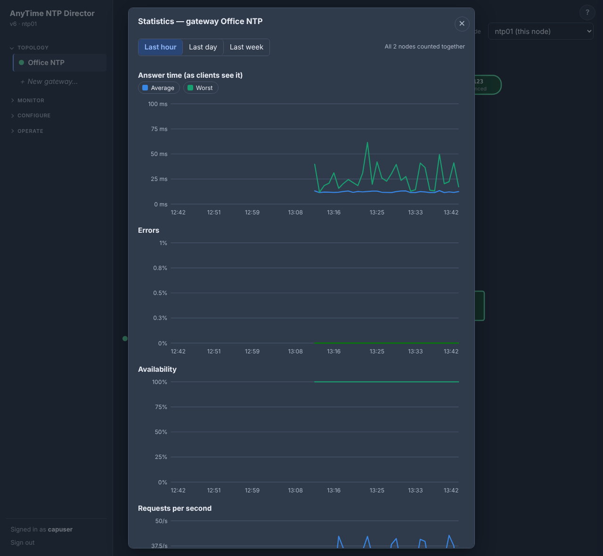

- A **server** (square) shows **round trip** (the average and worst of the answers), **failed probes** (the share of the server's own probes that failed, which is what decides whether it is up) and **failed requests** (the share of client requests sent to it that failed: no answer in time, or a kiss-o'-death).
- The **gateway** (circle) shows what clients get: **answer time** (one answer in eight is timed), **errors** (failed requests and kiss-o'-death answers, not clients turned away by the client list or rate limit), **availability** (the share of the 2-second checks, the same ones that drive the circle's uptime, that found the gateway working; paused or not-yet-started time is not counted) and **requests per second**.

A server's graphs are the picked node's own view. A gateway's graphs add up every reachable node of the cluster, since which node answers a client is up to the clients; the dialog says "All 3 nodes counted together", or how many were counted and how many did not answer (a single node shows just this node). A gap means nothing happened in that time: paused, the node was down, or, for a server, nothing was asked of it. The history is kept per node for 7 days, one slot per minute, and saved with the other statistics (`stats.json.gz`, every 5 minutes and when AnyTime stops), so a restart keeps it; the time AnyTime was down is a gap. A server address listed by two gateways is one series, and a gateway's series covers all its addresses (IPv4, IPv6, anycast) on this node.

### Pools, families and the cluster

- Each gateway has its **own pool**, and two gateways may use different servers. A server can be an IP (`10.0.0.124`, `10.0.0.124:1123`, `[2001:db8::123]`) or a host name (resolved each time it is probed).
- A gateway may have an IPv4 and an IPv6 address (one engine per family). NTP servers can be IPv4, IPv6 (`2001:db8::123`, `[2001:db8::123]:1123`) or names.
- A gateway may hold **more than one address per family**, all in the subnet of its VIP: Edit gateway ▸ *More IPv4 addresses* / *More IPv6 addresses* (comma separated, no prefix length; `more_vip4` and `more_vip6` in the file, up to 32 each). They fail over with the VIP, are answered in ARP / neighbor discovery the same way, and answer NTP through the same pool and statistics. The VIP stays the one the nodes find each other by. An address of another subnet is an anycast address instead.
- In a cluster the whole drawing (address, servers) is shared and edited anywhere. The network interface stays per node.
- Two gateways cannot use the same shared address. An anycast address may be on several gateways (see [Anycast addresses and BGP](#anycast-addresses-and-bgp)); it is held while any of them can answer.

### The same thing on the command line

`ntpdir --canvas` prints the same tree and the same colours, and the other commands change it:

```
ntpdir --canvas                                  # tree with status
ntpdir --canvas-add gateway --vip 10.0.0.123/24 --interface eth0 \
     --server 10.0.0.124                        # circle + first square
ntpdir --canvas-add server --group 100 --server 10.0.0.125
ntpdir --canvas-del server --group 100 --server 10.0.0.125
ntpdir --canvas-add fallback --group 100 --server 0.pool.ntp.org   # used only while every server is down
ntpdir --canvas-set gateway --group 100 --vip6 2001:db8::123/64      # add IPv6
ntpdir --test-vmac --group 100                                # do virtual MACs reach this node? (changes nothing)
ntpdir --canvas-set gateway --group 100 --real-macs on        # no virtual MACs, on every node (off undoes it)
ntpdir --canvas-set gateway --group 100 --label "Office NTP"  # a name instead of the address (--label - clears)
ntpdir --canvas-set gateway --group 100 --spread-band 200     # this gateway's own load balancing (also --spread on|off, --max-stratum,
                                                           #   --max-root-distance, --max-offset, --fail-threshold, --max-attempts,
                                                           #   --latency-alpha); --lb settings goes back to following Settings
ntpdir --canvas-set server --group 100 --server 10.0.0.124 --label ntp-a   # a server's name (also on --canvas-add server; - clears)
ntpdir --canvas-add anycast --group 100 --address 203.0.113.123   # an anycast address (--canvas-del anycast removes one)
ntpdir --canvas-add dnsdirvip --group 100 --address 203.0.113.53  # answer NTP on an anycast address dnsdir announces (--canvas-del dnsdirvip stops)
ntpdir --canvas-set gateway --group 100 --anycast A,B           # or replace the whole list (--anycast - clears)
ntpdir --canvas-del gateway --group 100 --yes
```

A new gateway gets the group number 100, the next one 101, and so on (`--group N` picks another). Each CLI step is saved at once. In the file it is an `ntp` block inside the group:

```
"ntp": { "servers": ["10.0.0.124", "10.0.0.125"], "fallback_servers": ["0.pool.ntp.org"] }
```

Groups without their own `ntp` block use the top-level one.

## Anycast addresses and BGP

### Anycast addresses

A gateway can carry extra addresses of **any subnet** next to its shared address (`extra_vips`). In the GUI, right-click the gateway circle ▸ *Add anycast address*; each address becomes a pill beside the circle with its own menu. On the command line, use `--canvas-add anycast --group 1 --address 203.0.113.123`, `--canvas-del anycast …`, or `--canvas-set gateway --group 1 --anycast A,B` to replace the whole list.

Anycast addresses are not checked against the interface and do not take part in the election. **Every** node running the gateway puts them on `lo` and answers NTP on them, with the same servers and failover as the shared address, on `listen_port`. They are shared across the cluster and need NTP servers on the gateway.

An address is held only while this node can answer on it: the gateway is running and not paused, the listener is up, and at least one NTP server is healthy. Otherwise it is taken off `lo`, so the route disappears from your routing daemon. It is added with a 10-second lifetime that AnyTime renews every 3 seconds, so if AnyTime crashes or hangs, the kernel removes the address by itself within about 10 seconds instead of leaving a route that nothing answers.

The drawing and `--canvas` show whether each address is announced from the node you are looking at. When the node manages BGP, the pill is **green** when every neighbor of its family has an established session (IPv4 address → IPv4 neighbors, IPv6 → IPv6), **amber** when some do and some do not, and **red** when none does, when it has no neighbor of that family, or when BGP is disabled on the node (Operate ▸ Anycast). A neighbor that is disabled or still connecting counts as not established.

### NTP on dnsdir's anycast addresses

Only when the Anyname DNS Director (`dnsdir`) is installed on the same host. BGP is then dnsdir's (see below), so ntpdir cannot announce anything itself, but a gateway can **also answer NTP on anycast addresses that dnsdir announces** (`dnsdir_vips`). In the GUI, right-click the gateway circle ▸ *Add dnsdir address* lists what dnsdir announces (read from `/var/lib/dnsdir/dnsdir.conf`, the `extra_vips` of its gateways); on the command line use `--canvas-add dnsdirvip --group 100 --address 203.0.113.53` and `--canvas-del dnsdirvip ...`. The pill sits under the anycast pills.

ntpdir only **listens** on the address. dnsdir holds it on `lo` and announces it; ntpdir never adds it, removes it or withdraws it, and never touches FRR. Packets sent to the address are relayed to the gateway's NTP servers like any others, on the gateway's NTP port. The pill is green while dnsdir has the address on `lo` and a server answers, amber when dnsdir holds it but no NTP server answers (dnsdir still announces it, so clients get no answer), and grey while dnsdir does not hold it, no longer announces it, or is gone; ntpdir looks again every few seconds, so installing or removing dnsdir needs no restart. An address dnsdir does not announce is refused (GUI, CLI and API); one already saved stays when dnsdir goes away and is answered again when it returns. The list is shared by the cluster. An address is either ntpdir's own anycast address or dnsdir's, and only one gateway may answer on a dnsdir address.

**Because dnsdir decides when the address is announced, it knows nothing about NTP health.** If dnsdir's DNS is up and every NTP upstream is down, the route stays and NTP clients get no answer.

### BGP through FRR

**Not with dnsdir on the same host.** The Anyname DNS Director manages `/etc/frr/frr.conf` too, and two products rewriting one file would wipe each other's BGP setup. When ntpdir finds dnsdir installed (`/usr/local/sbin/dnsdir`, `/usr/local/share/dnsdir` or `/etc/systemd/system/dnsdir.service`) it logs that at start-up, leaves FRR, `frr.conf`, the `daemons` file and its own marker alone, treats BGP as off, and refuses to set up or enable BGP (GUI, CLI and API); clearing the settings and disabling still work. BGP settings already in the config are kept but have no effect, and the Anycast pages say BGP is unavailable. The check is made each time, so removing dnsdir lifts the block without a restart. Anycast addresses themselves still work as plain addresses on `lo`.

AnyTime can drive FRR on a node so the anycast addresses are announced without any hand-written routing config. In the GUI that is **Configure ▸ Anycast**; the command line is below. It is **per node**: the AS, router ID and neighbors are never replicated, because a node usually peers with its own upstream router. Only the anycast addresses are shared.

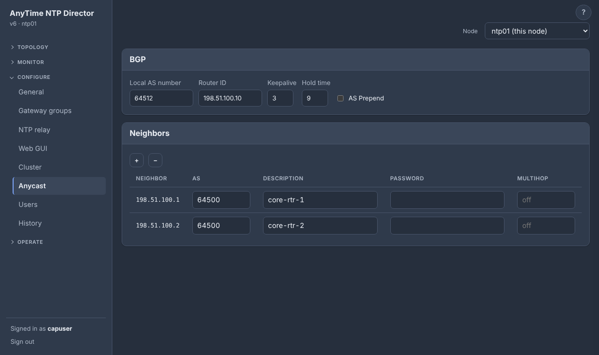

**Turning BGP on.** BGP runs on a node while a local AS number is set. That makes AnyTime the owner of the node's `/etc/frr/frr.conf`: it renders the whole file (BGP only), sets `bgpd=yes` and `bfdd=yes` in `/etc/frr/daemons`, and reloads FRR (`systemctl reload frr`; a restart when a daemon is switched on or off). FRR must be installed with its `frr-pythontools` package (the installer adds both). Without it a reload cannot work, so AnyTime restarts FRR for every change and the sessions drop briefly. An `frr.conf` that AnyTime did not write is saved once as `frr.conf.pre-ntpdir` before it is replaced. Do not run this on a host whose FRR is managed by something else; they would overwrite each other.

**Turning it off.** Clearing the AS number removes the BGP section and leaves FRR running (the router ID can only be set while an AS is set, and clearing the AS clears it). **Operate ▸ Anycast** does the same without forgetting any setting (*Disable BGP*), and can shut down a single neighbor (`neighbor … shutdown`; the neighbor stays configured). A node that never set an AS never has its FRR files touched.

**Settings.**

- BFD is on for every neighbor.
- BGP keepalive and hold time are settings next to the router ID (default 3 s and 9 s; `--keepalive S --hold S`, `-` for the default). The session uses the lower hold time of the two ends.
- **AS prepend** (Configure ▸ Anycast, a tick box; `--as-prepend on|off`; `as_prepend` in the `bgp` block) adds the local AS three more times to every anycast route the node announces (`set as-path prepend ASN ASN ASN` in the outbound route-maps), so routers prefer the nodes that do not have it. Tick it on the nodes that should be the backup.
- A neighbor can have a **multihop** limit (2–255, eBGP only) for a peer that is not on a connected subnet. FRR then runs BFD to it in multihop mode, so the peer must be set up the same way.

```
ntpdir --bgp                                                    # settings, neighbor and BFD state, announced addresses
ntpdir --asn 64512 --router-id 192.0.2.10        # --router-id needs an AS, set now or earlier
ntpdir --keepalive 3 --hold 9
ntpdir --as-prepend on                  # the local AS three more times on every announcement (off undoes it)
ntpdir --bgp-neighbor-add 192.0.2.1 --remote-as 64500 --description core
ntpdir --bgp-neighbor-add 2001:db8::1 --remote-as 64500
ntpdir --bgp-neighbor-add 10.0.1.5 --remote-as 64512 --multihop 2   # peer not on a connected subnet (e.g. AWS VPC Route Server)
ntpdir --bgp-neighbor-del 192.0.2.1
ntpdir --asn off                                 # also clears the router id
ntpdir --bgp-disable                             # stop BGP on this node, settings kept (--bgp-enable)
ntpdir --bgp-neighbor-disable 192.0.2.1          # shut one neighbor down, kept (--bgp-neighbor-enable)
```

**What the node does, and no more.**

- **It announces only its anycast addresses.** Each is a `network` statement, and an outbound route-map permits only those prefixes (`/32` and `/128`).
- **It accepts nothing.** An inbound route-map denies every route, so a peer cannot change the host's routing table.
- **An IPv4 address goes to the IPv4 neighbors, and an IPv6 address to the IPv6 ones.** Add a neighbor of each family to announce both.
- **A prefix is in FRR's table only while AnyTime holds the address on `lo`**, so it is withdrawn when no NTP server answers, the gateway is paused or AnyTime stops, and within about 10 seconds if AnyTime is killed (the address lifetime, above). Lower the router's timers to shorten the time your peers need to notice.
- **The neighbor password** is an MD5 TCP session password. It is stored in the config file and its history (root-only), and `--password` on the command line is visible to other users of the host, so the Anycast page is the safer place to set it.

**Where to look.** **Monitor ▸ Anycast** shows each neighbor's session and BFD state, read from FRR every few seconds (`vtysh -c "show bgp summary json"`, `show bfd peers json`), and which anycast addresses are announced. **Configure ▸ Anycast** (card *BGP*) has the AS, router ID and the neighbor table (**+** adds a row, **−** removes the highlighted one).

The generated config looks like this:

```
ip prefix-list NTPDIR-ANYCAST-V4 seq 10 permit 203.0.113.123/32
route-map NTPDIR-OUT-V4 permit 10
 match ip address prefix-list NTPDIR-ANYCAST-V4
route-map NTPDIR-IN deny 10
router bgp 64512
 no bgp default ipv4-unicast
 neighbor 192.0.2.1 remote-as 64500
 address-family ipv4 unicast
  network 203.0.113.123/32
  neighbor 192.0.2.1 activate
  neighbor 192.0.2.1 route-map NTPDIR-IN in
  neighbor 192.0.2.1 route-map NTPDIR-OUT-V4 out
 exit-address-family
```

### Cloud use (untested)

Clouds block multicast and ignore virtual MACs, so the gateway VIP cannot be reached there (real-MAC mode lessens the second problem, not the first). The anycast addresses can: they are plain `/32` routes announced over BGP. A possible setup follows, **not tried in any cloud**:

1. Give a gateway a VIP that is an **unused address in the node's own subnet** (a gateway only starts when the node has an address in the VIP's subnet), and list **every node's address** under *Neighbors (unicast mode)* so the nodes find each other without multicast. The list is shared, so you fill it in once. The VIP forms but nobody uses it.
2. Add the anycast addresses to that gateway and announce them with BGP (Configure ▸ Anycast). For a peer that is not on a connected subnet, such as an AWS VPC Route Server endpoint, set the neighbor's **Multihop** (usually 2); the peer must use multihop BFD as well.
3. The gateway joins the election only after its NTP servers answer, and an anycast address is announced only while a server answers.
4. In AWS, also turn off source/dest check on the instances, and allow BGP (TCP 179) and BFD (UDP 3784 and 4784) in the security groups.

## Gateway roles, virtual MACs and real-MAC mode

This section is the detail behind [How it works](#how-it-works), for when you need to know exactly what the nodes do on the wire.

### The VIP on controllers and forwarders

The AGC owns the VIP on its macvlan. An AFN is reached through its vMAC, but the kernel only accepts traffic for addresses it owns. So an AFN adds the VIP to `lo` as a /32 (/128) and sets `arp_ignore=1` and `arp_announce=2` on the parent interface and its macvlan, so it never answers or advertises ARP for the VIP. The AGC stays the only ARP and neighbour-solicitation authority.

### Who is controller

The node that is controller stays controller. A node that joins or restarts becomes a forwarder even when its priority is higher or its address sorts higher. It takes the role only if it has **preemption** enabled (the Settings switch) and outranks the controller, or if two controllers meet and one must give way. So after a node is restarted, the roles stay as they fell, instead of moving twice.

The controller marks its hellos with a flag (bit 3). A node that took over keeps its old slot number, so slot 1 alone no longer tells a joiner who the controller is. A leaving node sets bit 2.

### Slots and virtual MACs

A slot is one MAC (`00:1a:7c:<group>:<slot>:00`) on the wire, whichever address family uses it. A node takes the same slot in IPv4 and IPv6 when it can, and never one that a node it hears (in either family) already has.

A controller that gives way to a better one moves to a free forwarder slot. Two forwarders that picked the same slot settle it by rank (the lower one moves). The IPv4 and IPv6 sides of a node share the interface of a slot, which is removed only when neither uses it any more. The two families elect their controllers separately and may pick different nodes; the IPv6 controller then moves off slot 1 to a free slot, so no MAC is ever on two nodes.

### Real-MAC mode (no virtual MACs)

Virtual MACs need the network to deliver frames addressed to a MAC that is not the NIC's own. A VMware port group with promiscuous mode off drops them, and so do clouds that allow one MAC per interface. For those networks, a gateway has a setting, **Use real MAC addresses** (Configure ▸ Gateway groups; `real_macs` in the file; `--configure`). It is shared by the cluster, and changing it restarts the gateway.

It is **on for a gateway you create** (first start, Add gateway, `--canvas-add gateway`, `--configure`), because most networks need it. A gateway that already existed keeps the setting it had (a file that does not say `real_macs` means off), so an upgrade changes nothing. Off is the older way: a virtual MAC per node, which fails over without depending on the neighbors (see the last point below).

In real-MAC mode, everything above is replaced as follows:

- **No macvlan, no slot MAC.** Every node, the controller too, holds the VIP on `lo` and has `arp_ignore=1` and `arp_announce=2` set on the real interface (put back when the gateway stops).
- **The controller still answers** ARP and IPv6 neighbor solicitations for the VIP, and still picks a node by the load-balancing method. The answer names the **real MAC** of the node it picked: its own MAC for its own slot, and also for any node whose MAC it does not know yet (it holds the VIP too, so that is always right). It is sent from the controller's own MAC.
- **The controller learns the real MACs** without any change to the gateway protocol: from an ARP a node sends, from any IPv6 frame from a node's link-local address, and by asking (an ARP request or a neighbor solicitation of its own) for the ones it has not heard, again every minute. Nodes of any version take part.
- **A real MAC cannot be taken over.** When a node dies or leaves, the controller announces the VIP at its own MAC with an unsolicited ARP (or neighbor advertisement), now and twice more within a second. Neighbors that honor one repoint at once; the others keep sending to the dead node until their ARP entry ages out (a Palo Alto's default is 30 minutes). Check how your firewalls treat it, and turn the setting off for a gateway whose neighbors do not honor one. A planned stop gives the announcement a head start, because the leaving node stays up for a moment after the controller has been told.
- **The vMAC column** of Monitor ▸ Gateways shows real MAC addresses (the controller knows all of them; a forwarder only its own).

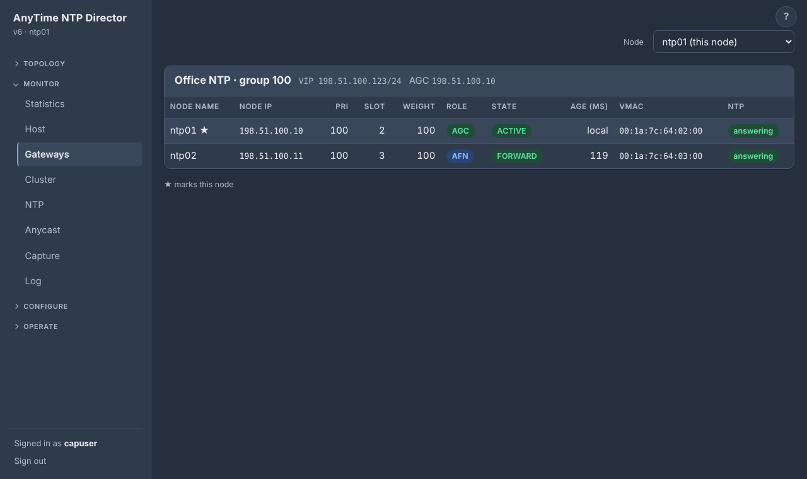

## The web GUI

Everything the command line does is also in a browser, over HTTPS on port **12380** (`web.listen`). The page follows the system light or dark theme automatically. The **?** at the top right of every page opens a slide-out help panel for that page, with its command-line equivalents and a description of every field on it.

Saving applies immediately, with the same hot reload as editing the file.

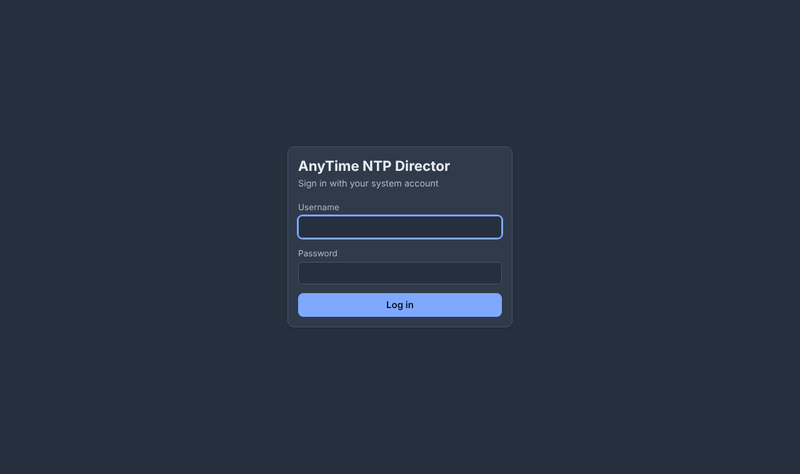

### Signing in

**Login** is backed by PAM: a user may log in if PAM accepts their password *and* they are a member of the `ntpdir` group.

```
groupadd ntpdir
usermod -aG ntpdir alice
cp contrib/pam.d/ntpdir.debian /etc/pam.d/ntpdir     # or ntpdir.rhel
```

Without `/etc/pam.d/ntpdir`, PAM falls back to its `other` policy, which usually denies everything. `root` is not special: add it to the group if you want it to log in. Removing a user from the group ends their session within a minute.

The PAM binding uses cgo, so build natively with `libpam0g-dev` (Debian and Ubuntu) or `pam-devel` (RHEL) installed. A build without cgo, including any cross-compile, has no PAM, so it **refuses to start the GUI** rather than serve it unauthenticated. The daemon and the command line work normally.

### Which page does what

| CLI | Web GUI |
| --- | --- |
| `--canvas`, `--canvas-add`, `--canvas-del` | Topology page (draw gateways and servers; live colours) |
| `--canvas-add node` / `--canvas-del node` `--group N` `--node NODE` | Topology page: right-click the gateway ▸ **Add node** / right-click a node ▸ **Remove from this gateway** |
| `--server-stats ADDR` `[--stats-range 1h\|1d\|7d]` | Topology page: right-click a server ▸ **Statistics** (latency and loss graphs) |
| `--canvas-move server\|anycast` `--group N` `--server ADDR` `[--address ADDR]` `--to N` | Topology page: drag a server left/right or an anycast address up/down |
| `--host-lookup IP\|NAME` | Add NTP server form: the Name is filled in from the address (reverse DNS), or the address from a name |
| `--gateway-stats GROUP` `[--stats-range 1h\|1d\|7d]` | Topology page: right-click the gateway circle ▸ **Statistics** (answer time, errors, availability, requests) |
| `--show-gateways`, `--show-neighbors` | Gateways page (roles, slots, vMACs, NTP listener state) |
| `--node-rename NAME` | Topology: right-click a node ▸ **Rename** (the host name and its `/etc/hosts` entry) |
| `--assert-agc` | Operate ▸ Node ▸ **Gateway controller**: "Make this node the gateway controller" (asks to confirm) |
| `--cluster-status` | Monitor ▸ Cluster (the members) |
| `--show-ntp` | NTP tab (ranking, health, round trip, offset, stratum, counters) |
| `--show-config`, `--configure` | Configure pages (form; every edit saves and applies at once) |
| `--versions`, `--version-show/-diff/-snapshot/-restore/-export`, `--config-import` | History tab |
| `--users`, `--user-add`, `--user-grant`, `--user-revoke`, `--user-passwd`, `--user-expiry`, `--user-del` | Configure ▸ Users |
| `--tls-status/-install/-csr/-revert/-regenerate` | Configure ▸ Web GUI (certificate) |
| `--cluster-status/-token/-join/-promote/-failover/-remove/-unremove/-leave/-sync` | Cluster tab |
| `--update-status/-history/-upload/-apply/-push` | Upgrade tab (stats at the top, upload, a paged History of every update event (`--update-history` prints them all; `--update-status` the newest 50), Nodes card: tick members, **Update this node now** / **Update N selected**) |
| `--update-auto` | Configure ▸ General ▸ **Upgrade** card |
| `--update-repo` | Configure ▸ General ▸ **Upgrade** card (Online repository) |
| `--update-cancel` | command line only (the Upgrade tab shows what is queued) |
| `--stats-clear` `[--all-nodes]`, `--scan ADDR`, `--ping ADDR\|NAME`, `--traceroute ADDR\|NAME` | Statistics page: **Clear**; right-click a client ▸ **Scan**, **Ping**, **Traceroute** |
| `--stats` `[--stats-range 1h\|1d\|7d\|30d] [--stats-outcome KIND] [--stats-client ADDR \| --stats-server ADDR] [--all-nodes]`, `--whois ADDR` | Statistics page (Monitor); `--whois` is right-click ▸ **Whois** |
| `--host` `[--host-range 1h\|1d\|7d\|30d] [--all-nodes]` | Host page (Monitor); `--all-nodes` is the Node menu's **Cluster** entry (also on Statistics) |
| `--capture IFACE` `[--capture-seconds N] [--capture-filter EXPR] [--capture-file FILE] [--all-nodes]`, `--capture-interfaces` | Capture page (Monitor); `--all-nodes` is the Node menu's **Cluster** entry there |
| `--tshoot` `[--all-nodes] [--tshoot-file F]` | Log page ▸ tshoot |
| `--log` `[--log-min LEVEL] [--log-grep WORDS] [--log-since 6h] [--log-lines N]` | Log page (Monitor) |
| `--power restart\|shutdown\|cancel\|status` `[--in MIN \| --at HH:MM]` | Operate ▸ Node ▸ **Host** |
| `--node-pause`, `--node-resume`, `--node-status` | Operate ▸ Node ▸ **Maintenance** (Pause / Resume this node) |
| `--bgp-disable`, `--bgp-enable`, `--bgp-neighbor-disable ADDR`, `--bgp-neighbor-enable ADDR` | Operate ▸ Anycast (Disable / Enable BGP, and per neighbor) |
| `--version`, `--help` | version in the header; the **?** at the top right of every page opens a slide-out help panel for that page (including its command-line equivalents and a description of every field on the page) |

### TLS and security notes

**TLS.** With no certificate configured, a self-signed one is generated next to the config file (`ntpdir-web.crt` and `.key`, key mode 0600) and renewed at start-up when it is within 30 days of expiry. Your browser will warn until you install a real certificate; see [The GUI certificate](#the-gui-certificate).

**Exposure.** The GUI can reconfigure a daemon that runs as root and listens on all interfaces by default. Bind it to a management address (`"listen": "10.0.0.5:12380"`) or firewall the port.

**Sessions and cookies.** Sessions are kept in memory and saved to `sessions.json` in the state directory (mode 0600, only a SHA-256 of each cookie), so an upgrade or a restart of the daemon does not sign anyone out; the idle timeout and the 12 hour limit still apply. Changing the GUI listen address does sign everyone out. A user's sessions also end when that user's password changes, the account is deleted or it expires. Cookies are HttpOnly, Secure and SameSite=Strict, named with the `__Host-` prefix. Every change carries a CSRF token, and a strict CSP (no inline script) is in force.

**Failed logins** are limited. By default, 3 wrong passwords within 1 minute lock that address, and that address together with that user name (never the user name alone), out for 15 minutes. All three numbers are on Configure ▸ Web GUI (`web.max_failed_logins`, `web.failed_login_window_minutes`, `web.lockout_minutes`). A failed login gets one message that does not say what was wrong, which group is needed, or how many tries are left, because that would give a guesser a target. Only once an address is locked out does the login page say "Too many failed attempts." and disable its form until the lockout ends.

**Passwords** set on the Users page must have at least 8 characters (`web.min_password_length`, 1–128; absent or 0 means 8).

**Management commands** (everything under `--versions`, `--tls-*`, `--cluster-*`, `--update-*`, and `--assert-agc`) go over the local status socket, which only root may use (file mode plus `SO_PEERCRED`).

## Users

Configure ▸ Users (or `ntpdir --users`) manages the accounts that may sign in to the GUI: the members of the GUI group (`ntpdir`, or `web.group`). They are ordinary operating-system accounts on the node, managed with `useradd`, `usermod`, `userdel` and `chpasswd`, so PAM stays the single place passwords are checked. A new account has no shell and no home directory and exists only to sign in. Each account can have an expiry date, and the operating system refuses it from that day.

The accounts are listed on the left. Pick one to change it on the right: type a new password and/or change the expiry date and press **Save** (leave the date blank and the account never expires). **Disable** takes the account out of the group while keeping it, and **Delete** removes it. **+ New** and **Add an existing account…** open their forms in the same place.

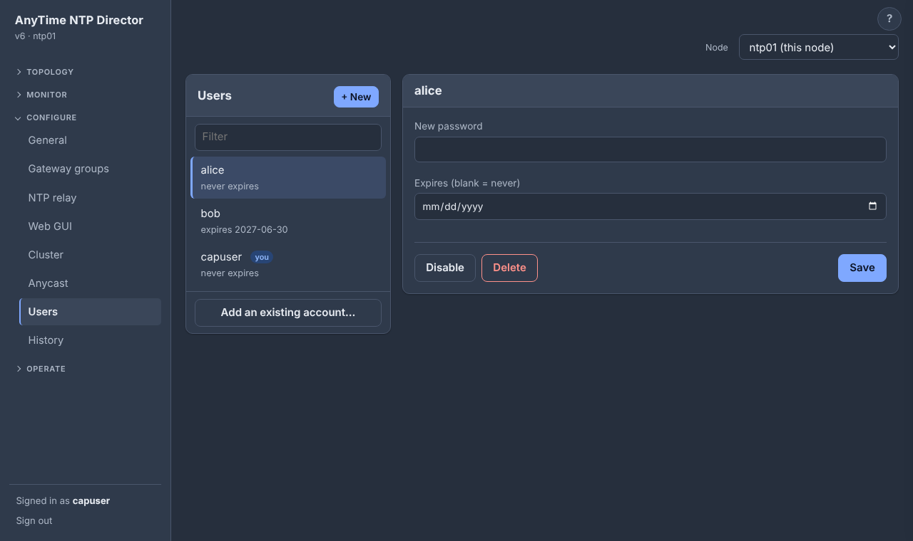

```
ntpdir --users
ntpdir --user-add alice --expires 2027-06-30     # asks for the password
ntpdir --user-passwd alice
ntpdir --user-expiry alice --expires never
ntpdir --user-grant bob                          # an account that already exists joins the group
ntpdir --user-revoke bob                         # leaves the group; the account is kept
ntpdir --user-del alice
```

**The rules.**

- Names are 1–32 lower-case letters, digits, `_` or `-`.
- Passwords go to `chpasswd` on its standard input, never on a command line.
- *Add user* never touches an account that already exists. **Add an existing account…** (`--user-grant`) puts one in the group with `usermod -aG` and, on the other nodes, adds it where it exists and creates it with the same password hash where it does not.
- **Disable** (`--user-revoke`) takes any member out with `gpasswd -d` and keeps the account. It is refused for yourself, for the last account, and for one that is a member only as its primary group.
- Only members of the group can be changed. `root` is never listed or changeable, and neither the signed-in user nor the last account that can sign in can be deleted.
- Any member can manage the others, which is the same power they already have over the daemon. Every change is logged with who made it. The installer adds the user who ran it to the group.

**In a cluster, every change applies to every node.** Add, delete, password and expiry are made on the node you are on and sent to the others over the cluster channel as the password *hash*; the password itself never leaves the node that received it. The reply says on how many nodes the change was applied and names any that were not (a node that was down misses the change, and the CLI exits with 2). To bring such a node in line, set the password again (that re-sends the whole account and creates it where it is missing), or repeat `--user-del` (a node where the account is already gone accepts it). A node never takes over an account that already exists there outside the GUI group.

**A node that joins a cluster gets the cluster's accounts.** Right after joining, it copies the GUI-group accounts (name, password hash, expiry) from the node it joined through. An account that already exists on the new node is left exactly as it is, and accounts with no password are not copied. If that fails, the join still succeeds and the log says so; set a password again to send it.

## Config history

Every change to the configuration, whether from the GUI, the CLI, a cluster sync or a hand edit of the file, is stored as a version in `/var/lib/ntpdir/versions` (one JSON file each; the newest 200 are kept). A version records when it happened, who made it (`alice`, `cli:root`, `file edit`, `cluster sync` and so on) and a one-line summary such as `NTP settings: probe_interval_ms 5000 → 7777`. Secrets (keys) never appear in summaries, and identical saves are not recorded again.

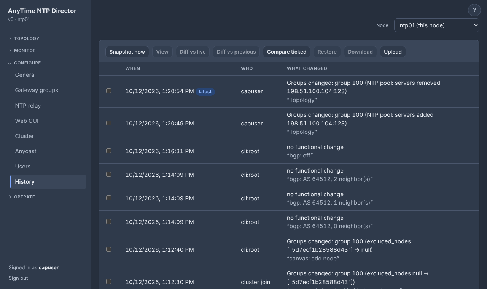

```
ntpdir --versions                         # list
ntpdir --version-diff 1790827200558       # that version → live config
ntpdir --version-diff A..B                # two versions
ntpdir --version-snapshot --note "before the VIP change"
ntpdir --version-restore 1790827179815    # applies it; the live config is saved first
ntpdir --version-export [ID] > ntpdir.conf  # download
ntpdir --config-import ntpdir.conf          # validate and apply a file
```

In the GUI, the History tab lets you view a version, diff it against the live config, the previous version or two selected ones, restore, download, upload and snapshot. A snapshot note can only be given on the command line. In a cluster, restoring changes the shared part through the primary, like any other edit.

## The GUI certificate

`web.cert_file` and `web.key_file` take precedence, and are re-read when the files change, so a renewal needs no restart. Without them you can manage the certificate at runtime, under Configure ▸ Web GUI or with the commands below.

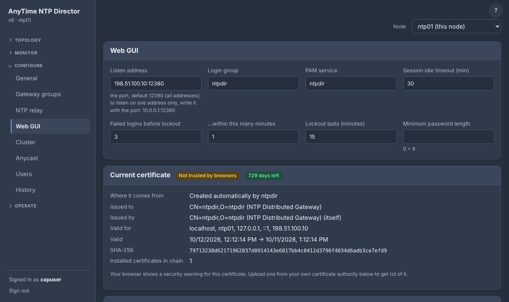

```
ntpdir --tls-status
ntpdir --tls-csr --cn gw.example.com --san gw.example.com,10.0.0.5   # key stays on the node
ntpdir --tls-install --cert-file gw.pem --key-file gw.key             # key optional after a CSR
ntpdir --tls-revert                                                   # back to self-signed
ntpdir --tls-regenerate                                               # new self-signed
```

An installed certificate is checked (chain order, key match, validity, server auth, names) and served from the next connection on, with no restart and no logout. The order of precedence is: files named in the config, then the installed certificate (or the one replicated from the cluster), then self-signed. The GUI warns when the certificate expires within 30 days. The primary's certificate is copied to every member, and reverting it on the primary reverts them all.

## Clustering

Clustering is for **management only**. It keeps the settings of several AnyTime nodes in step and lets you update them together, and it is independent of the AGC/AFN election. It is always on: every node is the primary of a cluster of one until it joins another. The only settings are:

```
"cluster": {"listen": ":12381", "self": "10.0.0.5:12381"}
```

`self` is the address the other nodes use to reach this node. Open TCP **12381** between the nodes.

The gateway protocol (election, heartbeats) uses UDP **12382** and the multicast groups `224.1.3.123` and `ff02::1:123`; open UDP 12382 between the nodes. These differ from the Anyname DNS Director's (4729, `224.1.3.7`, `ff02::1:307`), so both products can run on one host, provided their gateway ids differ. BGP is not available in ntpdir while dnsdir is installed (see below), so only dnsdir can announce anycast addresses.

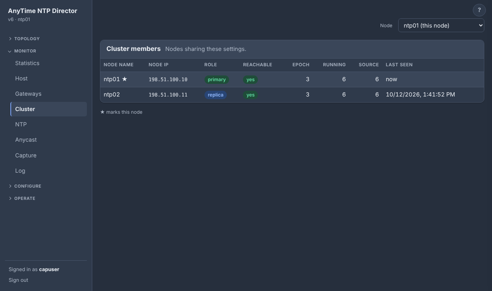

### How nodes reach each other

Nodes are reached by **every address they have**, not by one name. `self`, the host name, and all the node's IPv4 and IPv6 addresses (link-local and loopback excluded) go into the join code and are shared between members. The joining node tries them in order until one answers, and every later request tries the IP address that last worked first, then the rest.

IP addresses are tried before names, and a name is looked up for at most 2 seconds. Each node saves the addresses its peers report about themselves with the member list, so cluster traffic keeps working while a name cannot be resolved (the gateway being paused on every node, say), and also right after a restart. Addresses are re-read at every sync, so a changed IP is picked up on its own.

### Joining and roles

One node is the **primary** and the rest are **replicas**. A new node is the primary of a cluster of one. To join:

1. On any member, run `ntpdir --cluster-token`. It prints a join code (single use, valid for one hour).
2. On the new node, run `ntpdir --cluster-join 'ntpdir-join-v1:…'`. In the GUI, use Cluster tab ▸ Create join code / Join.

Joining replaces the new node's *shared* settings with the cluster's, after saving a snapshot of what it had.

### What is shared and what is per node

**Shared** settings are the NTP block and, per group, `group_id`, `name`, `vip4`, `vip6`, `more_vip4`, `more_vip6`, `key`, `lb_method`, `hello_ms`, `hold_ms`, `max_afns` and `neighbors` (the unicast list: every node's address; each node skips its own). **Per node** are the interface, priority, weight, preempt, the log level, and the web and cluster blocks.

You can edit anywhere. A change to shared settings made on a replica is forwarded to the primary, validated there, and replicated to everyone within the sync interval (5 seconds). A group added on the primary appears on replicas with the primary's interface and priority as a starting point.

### The node picker

In a cluster, the GUI has a drop-down at the top right to configure and monitor any member from the node you are logged in to. Requests are relayed over the cluster channel and recorded as `user via node`. Every page follows the picked node, including Cluster (leave, promote, join code, sync), Upgrade (upload, update now) and Configure ▸ General ▸ Upgrade (auto-update); only the sign-in is always on the node you logged in to. Uploads through another node are limited to 5 MB.

### Security between nodes

Nodes authenticate each other with a pinned per-node identity certificate (SHA-256 from the join code) and an HMAC over every request using the cluster secret, with timestamps and a replay cache. The cluster port is not the GUI port and is not affected by GUI certificates.

### Promotion, removal and the epoch

**Promotion is explicit.** If the primary is gone for good, run `ntpdir --cluster-promote` on the replica you want; the others follow. Nothing promotes itself after a failure, so a network split cannot silently create two primaries, and a primary that sees a higher epoch becomes a replica.

The **epoch** (shown on the Cluster page) is the counter that says which node is the primary. It starts at 1 and goes up by one on every `--cluster-promote` and on every planned hand-over, and at no other time. **Planned hand-over:** when the primary is restarted or shut down from the GUI or `--power now`, or restarts to install an update, it first gives the role to the reachable replica with the newest shared settings (one that is not itself updating); that node is the primary from then on, and the old one comes back as a replica. If no replica can take it, nothing changes. A primary that goes offline unexpectedly keeps the role until you promote another node or **automatic failover** does: when the primary has not answered for 5 minutes and a strict majority of the members (this one included) say so, the replica with the newest shared settings (then the newest version, then the lowest address) promotes itself and the others follow. `--cluster-failover auto|on|off` (Cluster page ▸ Failover) sets it for the whole cluster; auto is on from three members and off with two, where each side would see the other as down. A replica cut off from the others never has a majority, so it never promotes. The old primary comes back as a replica and shared-settings edits it took while cut off are overwritten. A restart or shut down scheduled with `--power ... in`/`at` (or with `shutdown` directly) hands the role over in the last minute before it fires; cancelling it before then leaves the role alone. Members follow the primary with the highest epoch; a returning old primary at a lower epoch is ignored, and two different claims at the same epoch are refused.

To manage members: `--cluster-remove ADDR` drops a member (it resets itself to a cluster of one when it next hears from the cluster), `--cluster-unremove` allows it back, `--cluster-leave` leaves from the node itself, and `--cluster-sync` syncs now.

### Members on different subnets

Members may sit in different subnets; the cluster only needs them to reach each other's cluster port. A gateway, however, runs on a node only if that node's interface has an address inside the gateway's VIP subnet for every family the gateway has, because the election runs on that network. IPv4 is always checked. IPv6 is checked when the interface has a global (non link-local) address, so globally addressed v6 gateways are protected too, while a node with only link-local v6 is let through.

A node without such an address does not start that gateway. It shows grey ("not running here — no address in the gateway's subnet"), is not counted as serving it by the update check, and starts it by itself within seconds of getting an address there. It stays a full cluster member and still takes shared settings and updates. A node that is already running a gateway when its address changes is not stopped. If the VIP prefix differs from the prefix the node has on the same link, the node is held back: give the node an address in the VIP prefix.

### How many members?

There is no member limit. Measured on one 2-core host with real daemons on loopback: 40 members joined in about 40 ms each. A settings change made on any member, primary or replica, reached all 40 within about one sync interval (5 seconds by default). The Cluster page answered in under 15 ms. Five members frozen (not refusing, just silent) were marked unreachable within seconds, did not slow the others, and caught up when resumed. Real networks add latency this loopback test cannot show.

A hand edit of the config file on a *replica* is not a shared edit and is overwritten by the primary's next sync; use the GUI or CLI there.

## Monitoring

The Monitor section of the GUI has pages for statistics, the host, packet capture and the log. Each has a command-line equivalent, and in a cluster each follows the node picked in the Node menu at the top right.

### Statistics

Monitor ▸ Statistics (or `ntpdir --stats`) shows what the NTP relay has done:

- the total number of requests and how they ended (Answered, Failed, Kiss-o'-death, Refused), and the **RPS** (requests per second in the last finished interval, with the peak of the range under it; click it to draw the rate in the chart),
- the number of different clients,
- a line chart over time (hover for the values, click a name in the legend to hide a line),
- donuts for the NTP version (v1 to v4) and the IP family, and
- the top clients (with the reverse-DNS name once it is known) and the top servers that answered them.

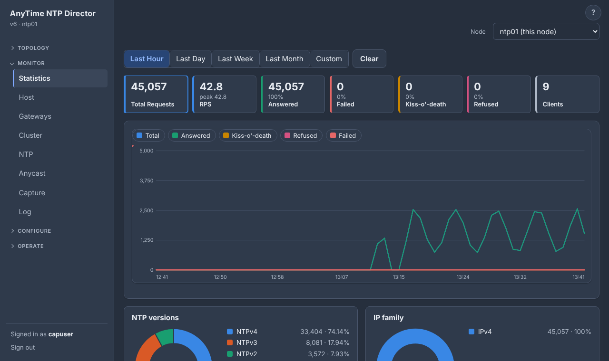

The range is Last Hour, Last Day, Last Week, Last Month, or a custom start and end.

**Drilling down.** Click a tile (Answered, Failed, Kiss-o'-death, Refused) to limit the chart, the donuts and the top lists to that outcome, for example to see which servers fail and for whom. Total Requests clears it. Click a client to list the servers that answered it, or a server to list the clients it served; this combines with the tiles.

**Naming a client.** Right-click a client in Top clients ▸ **Name** gives it a name by hand (up to 64 characters), shown under its address instead of the reverse-DNS name, found by the Filter box, and shared by the cluster (`client_names` in the `ntp` block: address to name). A named client's menu has **Rename** and **Remove name** instead.

**Filtering the lists.** The Filter box of Top clients and Top servers lists every client or server whose address or name contains what you type (any case, from everything counted in the range, not just the ten shown); Esc empties it. The box on one list does not change the other.

**Ping and traceroute.** Right-click a client or a server ▸ **Ping** or **Traceroute** opens a popup with the output of `ping -n -c 4 -W 2` or of `mtr -n --raw -c 10` (shown as the usual table, growing hop by hop), run on the node you are looking at (four pings, at most 15 seconds; mtr at most two minutes; four at a time). **Run again** repeats it. Both programs are prerequisites the installer adds; without them the popup says so.

**Scanning a client.** Right-click a client ▸ **Scan** runs nmap on the node you are looking at (`-Pn -F -sV -O`, the 100 commonest ports with service and OS detection, at most two minutes; two scans at a time). When it is done a popup shows a short summary: whether the host is up, its operating system, the MAC address and its maker, and the open ports with the service and version on each (twelve at most). nmap is a prerequisite the installer adds; without it the scan says so.

**Clearing the statistics.** **Clear** (next to the range buttons) forgets the counts and top lists of the node, or of every node when the Node menu says Cluster, and rewrites `stats.json.gz` at once.

**Whois.** Right-click a client or a server ▸ **Whois** opens a popup with the address block, name, organization, country and origin AS from its regional registry (found through whois.iana.org; none for private addresses). It is fetched only when asked for, by the daemon on the picked node (TCP port 43), and cached for a day. That sends the address, and nothing else, to the registry; a node without outbound port 43 says "not reachable".

**How long it is kept.** The counters are kept for **30 days**. They live in memory and are saved to `stats.json.gz` in the state directory every 5 minutes and when AnyTime stops, and read back at start-up, so a restart or an update does not empty them. The time AnyTime was not running is a gap. The file is gzip-compressed JSON, mode 0600, and holds client addresses; delete it, with AnyTime stopped, to forget them.

Top lists are collected in 10-minute steps for the last day and in hourly steps beyond that, keeping the busiest 300 clients and 600 servers per step (the rest count as "(others)"), so a flood of random addresses cannot use up memory.

**In a cluster.** Each node counts its own requests and has its own file; nothing is shared. Pick a member in the top-bar Node menu to see its statistics, or **Cluster** (its last entry, on Statistics and Host only) to see every node's numbers added together (`--all-nodes` on the command line).

```
ntpdir --stats
ntpdir --stats --stats-outcome failed          (also answered, kod, refused)
ntpdir --stats --stats-client 192.0.2.7        (the servers that answered that client)
ntpdir --stats --stats-server 10.0.0.124       (the clients that server served)
ntpdir --whois 192.0.2.7                       (registry record of an address)
ntpdir --stats --stats-range 1d
ntpdir --stats --stats-range 30d
ntpdir --stats --all-nodes                     (every cluster node's numbers added together)
```

### The memory guard

The statistics and the host history live in memory. Every 30 seconds AnyTime looks at how much memory the machine is using. That is the figure the Host page shows: what programs hold, caches excluded; in a container with a memory limit, the container's use against its limit, whichever is higher.

At **85%** or more it drops the **oldest data**. Each round removes the oldest tenth of the time span the statistics and the host history cover (top lists, per-minute counters and host minutes alike, so they stay consistent). It then hands the memory back to the system and measures again, up to 5 rounds per check, until use is below the limit. If it is still above, the next check carries on.

Newer data always outlives older data, and the newest hour of statistics and host history is never dropped. That hour is tiny, and a machine short of memory for another reason should not lose its recent history too. Cuts are made at whole hours so the top lists and the counters go together.

Each time it drops something, the log says so (WARN), and the Statistics and Host pages (and `ntpdir --stats`, `ntpdir --host`) show a line with the count, the time and what was dropped. What is dropped is gone from the saved file too after the next save.

The limit is the environment variable `NTPDIR_MEMORY_LIMIT_PERCENT` of the daemon (1–99, default 85); there is no other switch. It can only drop what AnyTime itself holds (at most about 100 MB), so if something else fills the machine, it will keep trimming and cannot fix that.

### Host

Monitor ▸ Host (or `ntpdir --host`) shows how busy the machine is: **CPU**, **memory**, **disk** (space used per filesystem, and how busy the busiest disk was) and **network** (traffic in and out of the real interfaces, and each link's use when the driver reports its speed).

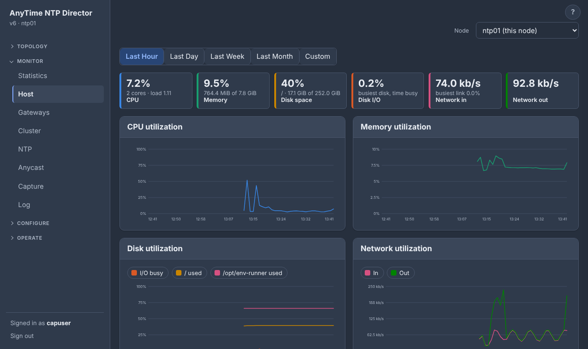

The daemon samples `/proc` and `/sys` every 10 seconds and keeps per-minute averages and peaks for **30 days** (about 4 MB in memory; saved with the Statistics file, so a restart keeps them). Tiles show the latest sample, four charts follow the range (Last Hour, Day, Week, Month or custom; hover for value and peak), and two tables list the filesystems and network interfaces. In a cluster the Node menu picks the member. Loopback, ntpdir's own `ntpdirN.M` links, container and bridge plumbing, and bridge or bond ports are left out of the network totals.

```
ntpdir --host
ntpdir --host --host-range 1d
ntpdir --host --all-nodes                      (the cluster as one machine)
```

With **Cluster** chosen in the Node menu (or `--all-nodes`), the nodes are added together. Network rates, load averages, memory, swap, disk sizes and cores are summed; CPU is averaged over all the cores; memory and each filesystem are taken per byte of the whole; disk-busy is the mean. A peak is the busiest node's (the network's is the sum of the nodes' peaks, an upper bound). A node that cannot answer is named and left out.

### Capture

Monitor ▸ Capture (or `ntpdir --capture`) is a `tcpdump` on any node of the cluster, or on all of them at once. It only listens: nothing is sent and nothing is changed. It uses a raw socket (no libpcap), so it needs only the privileges the daemon already has, and it does nothing until you press Start.

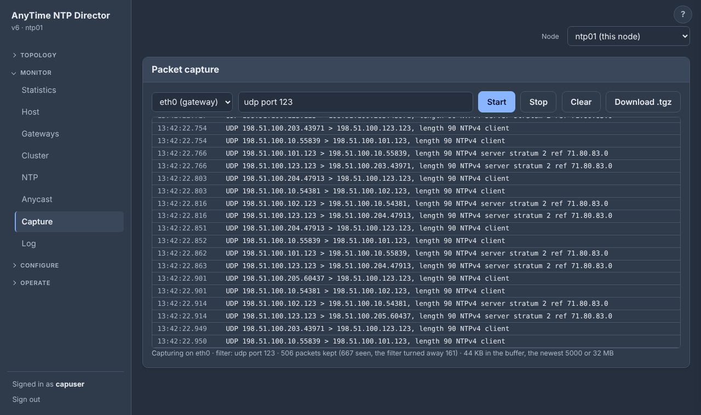

**One node** (the Node menu picks it). Choose an interface (a gateway's is marked; the virtual-MAC `ntpdirN.M` interfaces are listed too), optionally a filter, and Start. The newest packets are listed live, one line each, with TCP flags, NTP packets (`NTPv4 client`, `NTPv4 server stratum 2`, `kiss-o'-death RATE`) and, for ARP and IPv6 neighbor discovery, the Ethernet addresses they were sent from and to, so a virtual MAC that is announced but not the one that answers shows at once. The buffer holds the newest 5000 packets or 32 MB. **Download .tgz** saves it as an archive with one `.pcap` in it, for Wireshark. A node has one capture of its own: starting another replaces it.

**Every node.** Choose **Cluster** in the Node menu, an interface (every node needs one of that name), a filter, and 5, 10, 30 or 60 seconds. All nodes capture at the same moment into a buffer of their own (so nobody's Capture page is disturbed) and keep their newest packets (about 4 MB each). **Download .tgz** gives one `.pcap` per node (this node's ends in `-this-node`), a `summary.txt`, and an `errors.txt` naming any node that could not capture and why (a node on a version without capture says so). One capture of this kind runs at a time. It is the way to see whether what one node sent is what another received.

**The filter** is a small version of the tcpdump language, applied in the daemon before a packet is kept:

- `host`, `src host`, `dst host`, `net 10.0.0.0/24`
- `port 123`, `src port`, `dst port`, `portrange 50-60`
- `tcp`, `udp`, `icmp`, `icmp6`, `arp`, `ip`, `ip6`, `ntp` (port 123)
- `ether host 00:1a:7c:01:02:00` (also `src` and `dst`)
- joined with `and`, `or`, `not` and brackets; a protocol before host, net or port narrows it (`udp port 123`).

Addresses only, no names. A filter that is not understood is refused when the capture starts. The filter runs in the daemon, not in the kernel, so a very busy interface still costs the daemon every packet; keep captures short.

```
ntpdir --capture-interfaces
ntpdir --capture eth0 --capture-seconds 10 --capture-filter "host 10.20.0.205 and port 123"
ntpdir --capture eth0 --capture-file /tmp/eth0.pcap
ntpdir --capture eth0 --capture-seconds 30 --all-nodes --capture-file /tmp/cluster.tgz
```

Without `--capture-file` the packets are printed (the first 500); with `--all-nodes` a file is required. Every start is logged with the name of the user who made it.

### Log

Monitor ▸ Log (or `ntpdir --log`) shows the daemon's log and filters it by words (every word must appear), by level, by time range and by line count, with the matches marked. **Live** mode follows the newest line, and **Download** saves what is on screen. With the Node menu the page shows any member's log. `--log` without `--log-lines` prints the whole matching log.

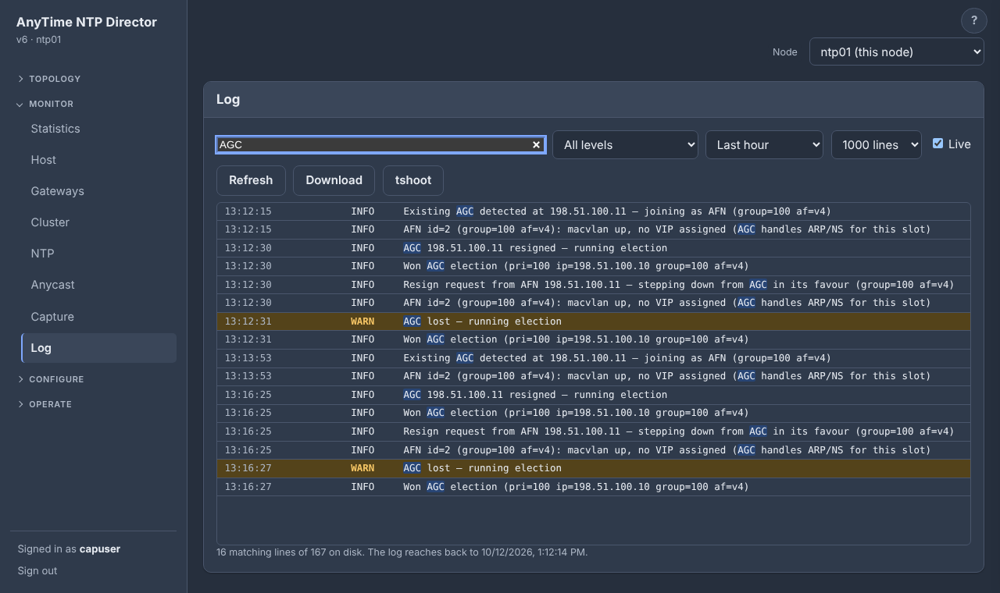

The text is the same that goes to stderr (the system journal under systemd). AnyTime also keeps it in `ntpdir.log` in the state directory (`/var/lib/ntpdir`, root-only), rotated at 2 MB with the two previous files kept, so it survives restarts and needs no journal access. Besides the usual events, it logs server up and down changes and each domain that starts or stops answering on a server, so one failing domain shows even while the server stays up.

**tshoot** (Monitor ▸ Log ▸ tshoot, or `ntpdir --tshoot [--all-nodes]`) downloads one `.tgz` with what is needed to find out why something does not work, from every node:

- the log (newest 20000 lines), the configuration and its versions;
- cluster, gateway, NTP, BGP, anycast, virtual-MAC and update state, and host numbers;
- addresses, links, routes, rules, neighbors, ARP, sockets, the ARP and routing sysctl settings, firewall rules, and FRR's BGP and BFD output;
- service status, the journal and the kernel log tail;
- 8 seconds of ARP and neighbor-discovery traffic per gateway interface (always; `--tshoot-capture` is still accepted and does nothing);
- a dump of every goroutine of the daemon (`ntpdir/goroutines.txt`: what it is busy with, for a node that is up but stuck). `kill -USR1 $(pidof ntpdir)` writes the same dump to standard error (`journalctl -u ntpdir`), for a daemon whose pages and cluster port do not answer.

Passwords, the gateway key, tokens, join codes and private keys are removed (each node's `README.txt` says how many), and other programs' command lines are not included. It is read-only, and a node that cannot be reached has a note in the bundle.

```
ntpdir --tshoot --all-nodes                # ntpdir-tshoot-HOST-TIME.tgz, every node
ntpdir --tshoot --tshoot-file /tmp/t.tgz   # this node only
ntpdir --log --log-min warn --log-since 6h
ntpdir --log --log-grep "server 192.0.2.123" --log-lines 200
```

## Operating a node

The Operate section of the GUI is for actions on a node: Node (controller, maintenance, host power), Cluster, Anycast and Upgrade. With the Node menu, each page acts on any member.

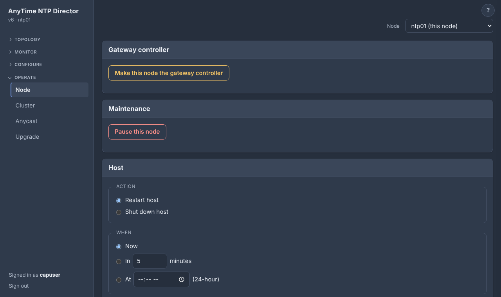

### Rename a node

Right-click a node on the Topology page ▸ **Rename** (or `ntpdir --node-rename NAME` on the node itself) changes the operating system's host name and `/etc/hosts` on that node. In `/etc/hosts` every name that was the old host name, short or full, becomes the new one, keeping the addresses, the other aliases and comments; when no line names the host, a `127.0.1.1` line is added. The host name is set with `hostnamectl`, or with `hostname` and `/etc/hostname` where systemd is not running. A name is letters, digits and hyphens, in up to four parts separated by dots. If the host name cannot be set, `/etc/hosts` is put back as it was. The cluster identifies nodes by address, so a rename changes only the name shown.

### Make this node the gateway controller

Operate ▸ Node (or `ntpdir --assert-agc`) asks the current controller to hand the shared address to this node. The node takes the role first (the VIP on its macvlan, announced) and only then asks the old controller to step down. The old controller steps down in place: it keeps its own virtual MAC, the MACs it covers and its NTP up (it only stops answering ARP and neighbour solicitations and moves the VIP onto `lo`), and releases a MAC it no longer needs after a few seconds.

When a controller stops (a restart, an update, **Pause this node**), it tells the group twice, and the node that takes over announces the MAC it inherits again and again for a couple of seconds, so the last word at the switch is the new owner's. A controller that dies is noticed after the hold time, as before. To prefer a node permanently, raise its priority and turn on preemption in Settings.

### Maintenance: pause this node

Operate ▸ Node ▸ *Maintenance* (or `ntpdir --node-pause`, `--node-resume`, `--node-status`) pauses every gateway on the node in one step. It resigns, stops answering NTP and stops probing, and the other nodes carry the traffic; the gateway controller role moves to another node, and if this node was the cluster's primary the primary role is handed to a running node too. Nothing is shut down.

The flag (`node_paused` in the config file) is local to the node, never replicated, and survives restarts of AnyTime and of the host. Resuming brings the gateways back once their NTP servers answer. A gateway you paused on its own stays paused after the node resumes. With the Node menu, the page pauses any member, so to send all traffic to one node (to benchmark it, say), pause the others instead of shutting them down.

```
ntpdir --node-pause
ntpdir --node-resume
ntpdir --node-status
```

### Restart or shut down the host

Operate ▸ Node ▸ *Host* (or `ntpdir --power`) restarts or shuts down the whole host: now, in 1–10080 minutes, or at a time of day. A scheduled action is kept by the operating system (`shutdown(8)`, so it survives a restart of AnyTime), shows on the page, and can be cancelled. It needs `shutdown` (systemd or sysvinit-compatible) on the host.

An action started *now* is refused when this node is the only member serving one of its gateways (the same check updates use). The GUI asks whether to go ahead anyway, and the CLI needs `--yes`. The check is made when you ask, not at a scheduled time. A stopping controller announces that it is leaving, so another member takes over at once.

```
ntpdir --power restart --in 10
ntpdir --power shutdown --at 02:30
ntpdir --power status
ntpdir --power cancel
```

## Upgrading a running cluster

Upload a release archive (`ntpdir_vN.tgz` or `.zip`, the same one you would install from) on the Upgrade tab, or with `ntpdir --update-upload FILE`. The node checks it (safe extraction, module `ntpdir`, integer `VERSION`), keeps the source under `/var/lib/ntpdir/update/source` and offers it to its peers. Instead of a file you can tick **Fetch from online** next to the file box: **Upload** then has this node download the newest release of `micush/ntpdir` (or its highest `v<number>` tag when there is no release; the same lookup `get.sh` does) and stage it exactly like an uploaded archive. The node needs to reach api.github.com and github.com.

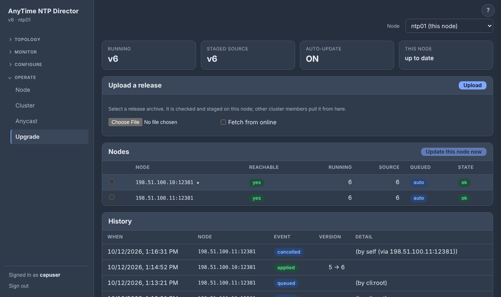

```
ntpdir --update-status
ntpdir --update-apply                 # build and install on this node now
ntpdir --update-push all              # ask nodes (or ADDR,ADDR) to update
ntpdir --update-auto on               # every node follows the newest source
ntpdir --update-repo https://github.com/you/ntpdir   # where "fetch online" downloads from (default: micush/ntpdir)
ntpdir --update-cancel all
ntpdir --update-history
```

### How a node updates

Each node that is asked pulls the source from the peer that has the newest one and **builds it natively** (the Go toolchain, gcc and the PAM headers, which is what `install.sh` sets up). It checks the result (version number, PAM linked), keeps the old binary as `/var/lib/ntpdir/update/ntpdir.prev`, swaps it in and re-executes itself.

A new binary that does not stay up is rolled back automatically (three boot attempts; it is confirmed after 60 seconds), and the failure is shown in the Upgrade tab. The queue and the auto-update setting are cluster-wide and live on the primary. Run it under a supervisor that restarts the process; the unit does (`Restart=always`).

### One node at a time, and only while the gateways stay served

Nodes update one at a time, and **only while the gateways stay served**. A node holds back its update until every gateway it is serving is also being served by another reachable member, so a node that is still recovering from its own update keeps the next one waiting. **The first node to take a new version is the canary:** the others hold while it has run the new version for less than 2 minutes, while any gateway on it shows bad, and while an update to that version has failed on any member (including one the boot guard rolled back, which stays failed until a newer version is staged, and one that vanished while updating) (a canary that crashes restarts the clock, and one that rolls back holds the rest for the retry period). While it soaks, an hourglass next to its name shows `soaking: Ns remaining` when you hover it. Once one node has settled, the rest follow in turn. A node that stops answering while it installs an update is shown as restarting (grey on the Topology, "restarting" on the Cluster and Upgrade pages), not as down, for up to 5 minutes after it was last seen. `--update-apply` on one node refuses in the same situation unless you add `--yes` (the GUI asks).

A node that is not clustered, is the only member, or serves nothing is never held back (a lone node restarts briefly; nothing could cover for it). The same goes for a gateway that no other member can serve because they are all on another subnet (sites that each have their own gateway): waiting for them would be for ever, so that gateway no longer holds the update back.

**Paused nodes update first.** A node that is paused serves nothing, so it can restart at any time. A member that is held back only because it is the sole one serving a gateway (the others are paused or down) does not make the rest wait for it: the paused nodes update one after another, then you resume one and the last node follows. The held node says why on the Upgrade page.

### No outage while a node restarts

After building, the node does not restart until another member has been serving each of its gateways for at least 15 seconds (the same check that gates a rolling update; `--update-apply --yes` skips it). A stopping node says so: a controller announces that it is leaving and the best remaining node becomes controller at once, and a forwarder tells the controller, which covers its virtual MAC immediately instead of a hold time later.

Whoever covers a MAC also announces it on the wire (an ARP probe or IPv6 DAD solicitation from that MAC, which changes no host's neighbour cache). A switch or a Linux bridge keeps a MAC on its old port until something transmits from the new one, and clients cached on that MAC would lose their answers for about 3 seconds. A returning node announces its MAC once it can answer, and the controller hands the MAC back a moment later. Forwarders, and a controller for the MACs it covers, repeat the announcement every 2 seconds, so a switch entry that went stale is corrected in seconds. On start-up a gateway joins only after its NTP pool answers.

Measured with two real nodes in network namespaces on a bridge and a client sending NTP requests to the VIP every 100 ms, pinned to the restarting node's MAC: restarting the controller or a forwarder caused no failed requests.

## Build from source

```
# the Go module is in source/; docs/ has the changelog
cd source
go build -o ntpdir .          # no third-party dependencies
go test -race ./...
./ntpdir --config ./ntpdir.conf
```

## License

AnyTime is free software under the GNU General Public License, version 3 (see `LICENSE` next to this file).
